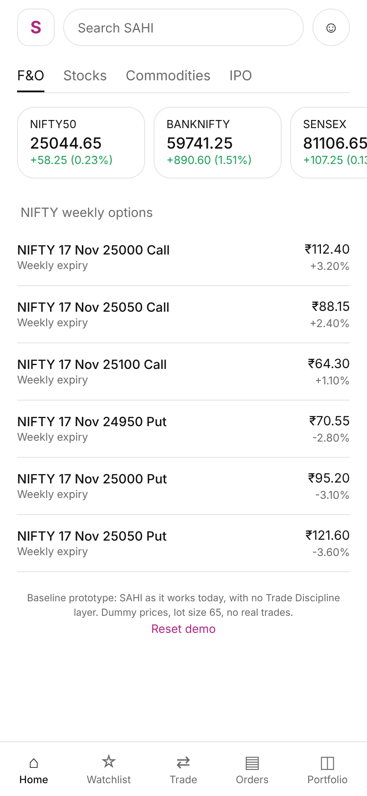
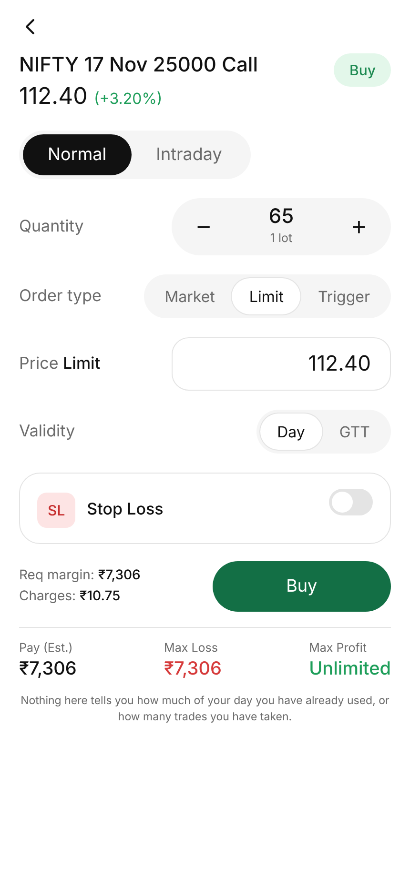
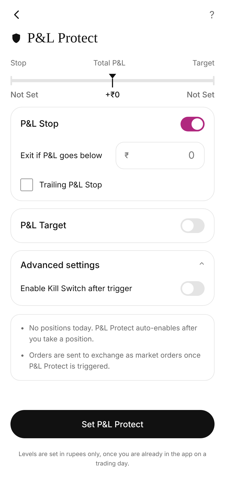
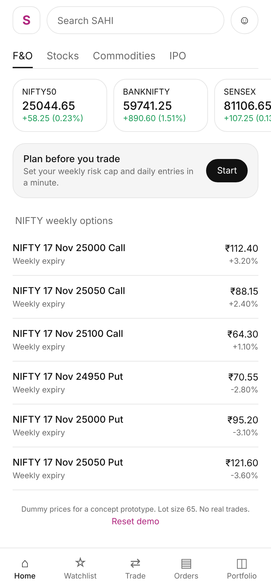
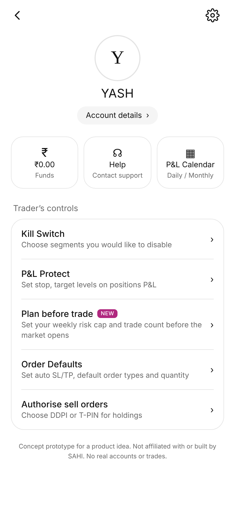
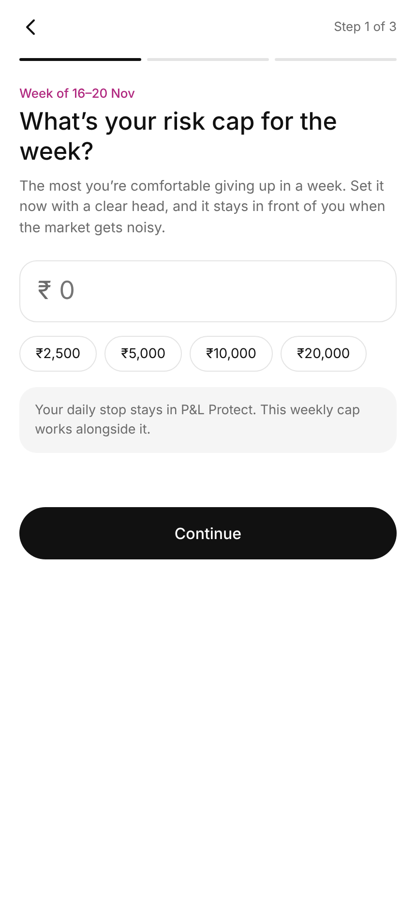
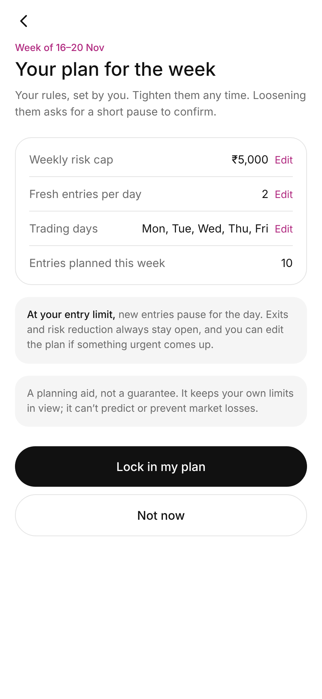
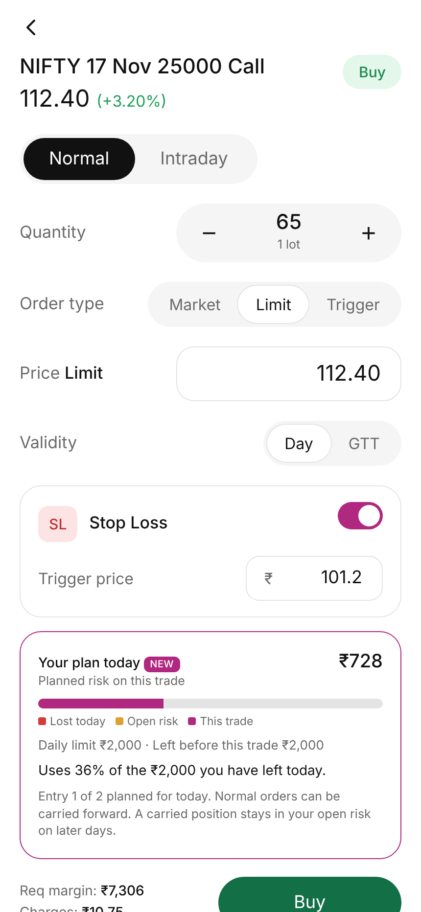
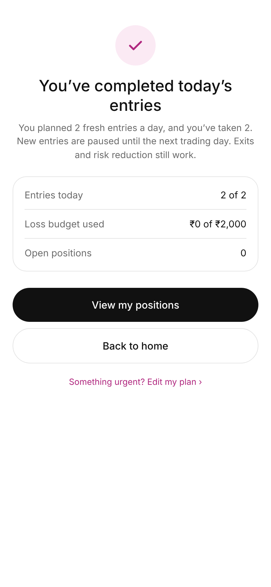
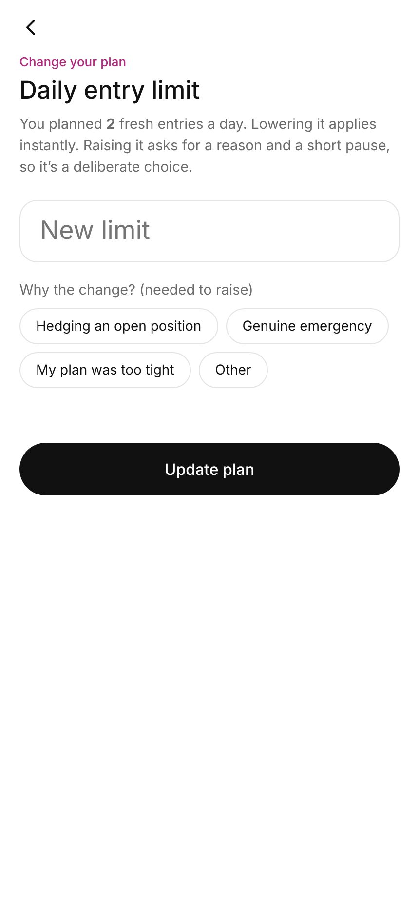

# Case Study: SAHI (Feature Suggested)

## Plan Before You Trade — a concept feature for overtrading

A clickable prototype exploring a fix for overtrading on SAHI, built on top of the existing P&L Protect feature.

Not affiliated with SAHI. This is an unsolicited concept I built to pitch, not a shipped or official feature.

## The problem

P&L Protect already stops a trader when the day's loss or profit target is hit. What it doesn't do is help with the pattern underneath that: it's rarely one bad trade that hurts, it's the fourth or fifth trade on a flat day, taken to recover a loss or chase a number, long before the daily stop is even close.

That's overtrading — and it's a behavior problem, not a risk-management problem. P&L Protect catches the outcome. Nothing today helps a trader catch the behavior earlier.

## The idea

**Plan Before You Trade**: once a week, before the market opens, a trader sets two numbers —

- a **weekly risk cap** (how much they're willing to lose this week, total)
- an **entries-per-day limit** (how many fresh trades feel reasonable on a normal day)

That's it. No daily loss number here — that's already owned by P&L Protect, so it's read from there, not asked twice. No weekly profit target either, because the problem being solved is losing too much, not winning too little.

From then on, every order ticket shows a small risk-preview card: what's been lost today, what's still open, what this trade adds, against the plan. When the day's entry count is hit, new entries pause — but exits and risk reduction always stay open, and a genuinely urgent change goes through a short "emergency edit" flow (pick a reason, wait 5 seconds, confirm) rather than being blocked outright.

The goal isn't to stop anyone from trading. It's to make the fifth trade a conscious choice instead of a reflex.

## What's reused vs. new

| Already in SAHI | This proposal | Why it's new |
|---|---|---|
| Daily stop & target (P&L Protect) | Reused as-is, read once | Never asked twice |
| Square-off on trigger | Unchanged | No new enforcement engine |
| — | Weekly risk cap + daily entry limit | Doesn't exist today |
| — | Pre-trade risk preview on the order ticket | Visibility before the order, not after |

## Prototype

Two versions, side by side, so the difference is obvious:

- **[`prototype.html`](./prototype.html)** — SAHI today + Plan Before You Trade
- **[`baseline.html`](./baseline.html)** — SAHI today, unchanged (P&L Protect only)

Both are single-file, self-contained HTML — open either directly in a browser, no build step. Dummy prices, no real trades, no backend.

## Walkthrough

**Today, without the new layer** — P&L Protect square-off logic, faithfully replicated:

| Home | Order ticket | P&L Protect |
|---|---|---|
|  |  |  |

**With Plan Before You Trade:**

| Home | Plan Before You Trade (in Trader controls) |
|---|---|
|  |  |

Setting the weekly plan — three questions, once a week:

| Step 1 of 3 | Review & lock in |
|---|---|
|  |  |

The risk preview, live on the order ticket:

Hitting the entry limit — new entries pause, exits stay open:

Genuinely urgent? Edit the plan — pick a reason, short pause, confirm:

## What I'd want to validate

This is a hypothesis, not a claim:

- Does a weekly entry/risk plan actually reduce the number of "revenge" trades on a losing day, or does it just move the friction around?
- What entry-per-day default would feel reasonable to a real trader rather than arbitrary?
- Does the emergency-edit flow get used the way it's intended (genuine emergencies) or does it become the default escape hatch, defeating the point?

I'd want real usage data and trader feedback to answer these, not just my own read.

## Links

- Loom walkthrough: https://www.loom.com/share/bf0f1e4be62441dbb5255b648ab1ff17
- One-page deck: [deck.pdf](./deck.pdf)

---

Built by Yash, exploring product problems in the trading space.
